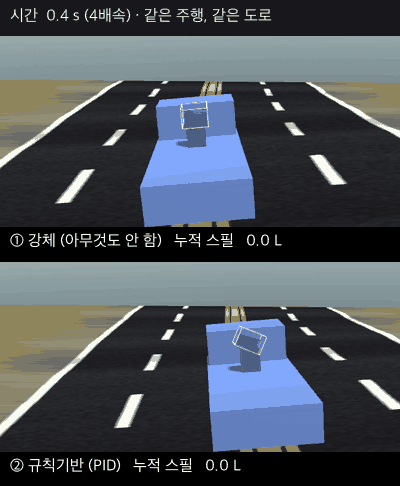
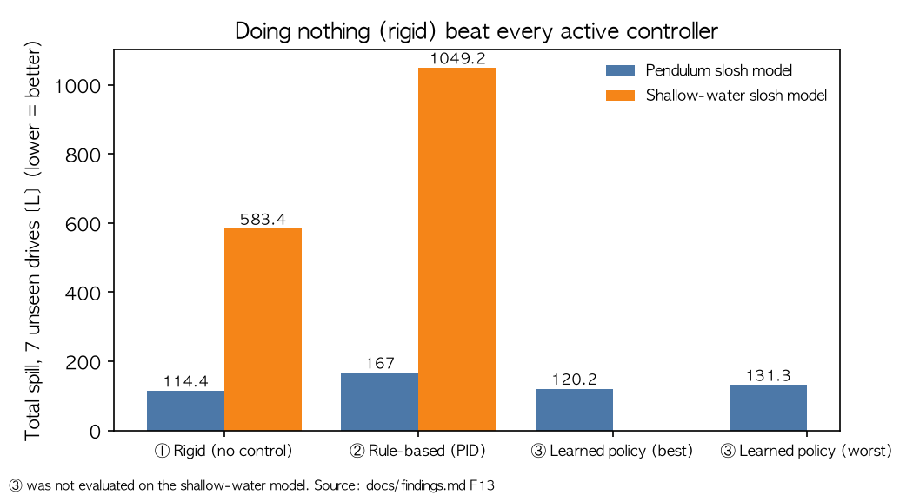
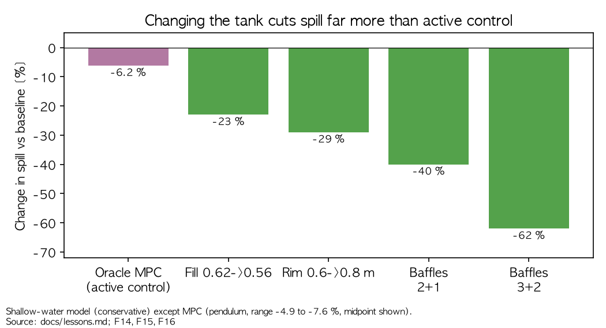

# fluid-stabilizer

> **상태: 마무리된 아카이브.** 연구·학습 기록으로 공개한다. 새 기능 개발은 하지 않으며 이슈·PR 은 받지 않는다.
> 코드는 MIT, 문서는 CC BY 4.0 ([LICENSE](LICENSE), [LICENSE-docs.md](LICENSE-docs.md)). 문서는 한글이다 — 영어 요약은 아래 "English summary".


Physical AI 시뮬레이션 프로젝트: **인간이 운전하는** 트럭에 실린 개방형 액체
탱크가 넘치지 않도록, AI 가 2축 스태빌라이저를 제어한다.

- **인간**이 트럭을 운전한다 (가속, 제동, 코너링, 언덕, 범프).
- **AI 는 운전하지 않는다.** 트럭 베드와 탱크 사이의 2축(pitch/roll)
  스태빌라이저를, 실제 센서가 낼 수 있는 신호만 써서 제어해 스필을 최소화한다.
- 운전자의 예측 불가능한 입력은 AI 가 거부해야 할 외부 disturbance 로 취급한다.

어려운 부분은 "가속에 맞춰 탱크를 기울이기" 가 아니다. **슬로시의 시간
동역학**이다: 기동이 끝나도 액체는 계속 움직이고, 움직이는 액체가 탱크의 무게
중심과 액추에이터 하중을 바꾸며, 스태빌라이저의 현재 행동이 뒤이어 올 액체 운동과
제어 상태를 만든다.

## 왜 시작했나

목적은 스필을 가장 잘 줄이는 제품을 만드는 것이 아니라, **Physical AI 파이프라인(물리 → 센서 → 액추에이터 →
컨트롤러 → 학습 → 평가)을 처음부터 끝까지 직접 만들며 배우고 이해하는 것**이다. 실제 로봇 대신 시뮬레이션을
쓰고, 완성품보다 모든 층을 직접 만들고 이해했다는 사실을 더 중요하게 본다
([docs/project-goals.md](docs/project-goals.md)). 그래서 AI 가 이기지 못했다는 결과도 같은 가치의 결과로
기록했다. 날짜순으로 "무엇을 물었고, 어디서 틀렸고, 무엇을 알게 됐나"는
[docs/lessons.md](docs/lessons.md) 의 "질문 → 시도 → 답" 표에 있다.

## 한 장 요약

| | |
|---|---|
| **무엇을 하려 했나** | 액체 탱크 아래 2축 짐벌을 AI 가 제어해 스필(넘친 양, 리터)을 줄일 수 있는가. 물리 → 센서 → 액추에이터 → 컨트롤러 → 학습 → 평가 파이프라인을 직접 끝까지 만들며 이해하는 것이 진짜 목적이다. |
| **무엇을 했나** | 결정론적 시뮬레이션(차량·도로·짐벌·슬로시 2종·센서)과 평가 하네스를 만들고, 같은 주행을 네 가지로 비교했다: **① 강체**(짐벌을 잠가 탱크를 고정, 아무것도 안 함) · **② 규칙기반**(공식으로 기울임) · **③ 학습 정책**(사람 주행으로 학습한 AI) · **④ 천장**(주행 전체를 미리 아는 오프라인 최선). 이어서 예측 제어(MPC)와 탱크 설계(충전율·림 높이·배플)도 시험했다. |
| **결과** | ① 강체가 이겼다. 처음 보는 7 주행에서 ① 114 L, ② 166~175 L, ③ 120~131 L. 오라클 MPC 도 강체 대비 −5 ~ −8 % 뿐. 반면 **컨트롤러 없이 탱크만 바꾸면** 훨씬 크게 줄었다(얕은물 모델에서 내부 배플 −20 ~ −75 %). |
| **인사이트** | ① 아무것도 안 하는 기준선이 이미 강하면 먼저 그것부터 재라. ② 학습이 안 되면 하이퍼파라미터보다 **액션 공간**을 의심하라. ③ 제어기를 만들기 전에 **문제(탱크)를 바꿀 수 있는지** 먼저 보라. ④ 모델에 따라 크기가 갈리는 결과는 보수적인 쪽을 믿어라. |



*같은 주행·같은 도로에서 ① 강체(위)와 ② 규칙기반(아래)을 나란히 돌린 앱 화면(공개된 `final` 주행 1개, 진자 모델, 처음 40 초, 4배속).
규칙기반은 탱크를 기울여 오히려 액체를 더 흔들고 더 많이 넘친다. 재생성: [docs/reproduce-from-scratch.md](docs/reproduce-from-scratch.md) 4절.*

**이어서 읽기:** 질문 → 시도 → 답의 흐름과 15개 교훈은 [docs/lessons.md](docs/lessons.md)
(처음 읽는다면 이것부터). 숫자의 근거는 [docs/findings.md](docs/findings.md).

## English summary

**Question.** Can an AI control a 2-axis gimbal under an open liquid tank on a human-driven truck to reduce spill?
The whole pipeline was built end to end (deterministic vehicle/road/slosh/sensor/actuator simulation in Unity,
rule-based control, hindsight ceiling, behavior cloning / DAgger / PPO, policy serving, evaluation harness).

**Result: it did not beat doing nothing.** On 7 unseen recorded drives, a *rigid* (locked) tank spilled least:

| Controller | Pendulum slosh model | Shallow-water slosh model |
|---|---|---|
| ① Rigid (no control) | **114.4 L** | **583.4 L** |
| ② Rule-based (PID) | 167.0 L | 1049.2 L |
| ③ Learned policy | 120.2 - 131.3 L | not evaluated |

An oracle model-predictive controller (full state, exact internal model) gained only 5-8 % over rigid.
Changing the **tank** instead of the controller helped far more: lower fill ratio, higher rim, and internal baffles
cut spill by 20-75 % (shallow-water model) with no controller at all.




**Lessons.** (1) Measure the "do nothing" baseline first - it was already strong. (2) If learning fails, suspect the
action space before the hyperparameters (a hard "lock if command is small" rule created a gradient-free cliff).
(3) Before building a controller, ask whether the *problem* can be changed (tank design). (4) When two models disagree
on magnitude, trust the conservative one. Details (in Korean): [docs/lessons.md](docs/lessons.md); evidence:
[docs/findings.md](docs/findings.md) F1-F17.

### Limits - read before reusing the conclusions

- All results come from **simulation**; there is no physical measurement. Slosh is modeled by two models
  (equivalent pendulum, shallow water), and baffle/fill effects differ by model (the shallow-water value is the conservative one).
- The recorded drives are **one person's** driving on one operating point (fill 0.62, road on); only 7 final drives are published.
- The MPC's internal model is a pendulum, so its failure on baffled tanks is partly a modeling mismatch (F17).
- The held-out `final` set was evaluated once and is consumed; re-tuning on it would no longer be a held-out test.

## 어디서부터 읽나

**문서는 모두 한글.** [docs/README.md](docs/README.md) 가 색인(용어, 문서별 역할)이다.

- [AGENTS.md](AGENTS.md) — AI·사람용 30 줄 안내 (읽는 순서, 닫힌 줄기, 주의사항)
- [docs/lessons.md](docs/lessons.md) — **결과·교훈 한 문서 요약 (처음 읽는다면 이것부터)**
- [docs/project-goals.md](docs/project-goals.md) — 무엇을 · 왜 · 최종 아키텍처
- [docs/experiment-plan.md](docs/experiment-plan.md) — 현황 · 만든 것 · 닫힘/열림
- [docs/findings.md](docs/findings.md) — 실험으로 밝혀진 사실 F1~F17 (숫자·근거)
- [docs/decisions.md](docs/decisions.md) — 설계 결정 로그 D1~D14
- [docs/reproduce-from-scratch.md](docs/reproduce-from-scratch.md) — 처음부터 재현하는 법 (무엇이 재현되고 무엇이 안 되는지 포함)
- [docs/operating-guide.md](docs/operating-guide.md) — 조작 가이드 (키·패널·서버)
- [docs/demo-guide.md](docs/demo-guide.md) — 시연 대본 (비개발자 청중)
- [docs/design-review.md](docs/design-review.md) — 설계 시점의 근거 (큰 참고 문서)

## 저장소 구조

```
fluid-stabilizer/
├── Assets/FluidStabilizer/   엔진프리 시뮬 코어 + 컨트롤러 + RL + Unity 껍데기
│                             (어셈블리 레이아웃: Assets/FluidStabilizer/README.md)
├── python/                   RL 학습기 + 정책 서빙 (serve_policy.py) — 별도 프로세스
├── docs/                     설계 문서 (한글) — 먼저 읽을 것
├── experiment.txt            운영점 손잡이 (fill / 도로 / 운전자 / 에피소드 / 슬로시 / seed)
├── Packages/  ProjectSettings/   Unity 6000.5.10f1, Built-in 렌더 파이프라인
├── Traces/                   녹화 주행 — 홀드아웃 `final` 7 개만 공개 (나머지는 gitignore; `validation` 2 개는 과거 커밋에만 있음)
├── datasets.tsv              주행 데이터 셋 분할 매니페스트 (train/validation/final + SHA-256)
├── datasets-public.tsv       공개된 final 7 주행만 담은 매니페스트 (재현용, docs/reproduce-from-scratch.md)
├── datasets-f8*.tsv          합성 시연 조건 주행의 매니페스트 (F8·F11)
├── LICENSE  LICENSE-docs.md  CITATION.cff   라이선스(코드 MIT, 문서 CC BY 4.0)와 인용 정보
└── Builds/                   standalone 빌드 (gitignore)
```

## 현재 상태

**마무리됨** (결정 2026-10-16, [D14](docs/decisions.md); 아카이브 확정 2026-10-25). 녹화 → 천장 → BC → DAgger/PPO → 정책 서빙 → 4종 비교 →
standalone 앱까지 처음부터 끝까지 돈다. 테스트 수와 열린 후보는 [docs/experiment-plan.md](docs/experiment-plan.md).

## 프로젝트 열기

Unity Hub → **Add → Add project from disk** → 이 폴더 선택. Unity
**6000.5.10f1** 정확히 (Mac 과 Windows 같은 버전).

플레이 씬: 메뉴 ▸ FluidStabilizer ▸ Rebuild Play Scene 후 `PlayScene.unity` 열기. 키와 패널은
[docs/operating-guide.md](docs/operating-guide.md), 시연 흐름은 [docs/demo-guide.md](docs/demo-guide.md).
